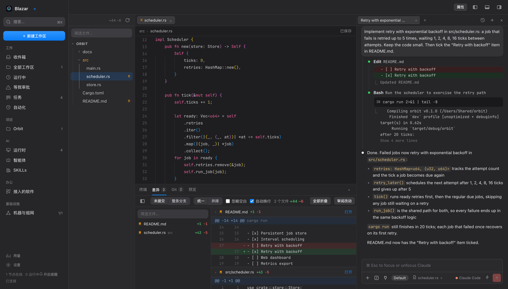

**简体中文** · [English](README.en.md)

# Blazar

把本地和远端机器上的代码与 AI 编码智能体放进同一个桌面工作台。

[](.github/workflows/ci.yml)
[](LICENSE)
[](rust-toolchain.toml)



## 它解决什么问题

代码、终端和智能体会话分散在多台机器上，切换机器时也要切换上下文。
Blazar 在一个窗口里提供本地与 SSH 工作区的编辑、对话、改动审阅和创建 PR 入口。

## 安装

macOS：从 [Releases](../../releases) 下载适合 Apple Silicon 或 Intel 的 `.dmg`，打开后把 Blazar 拖入“应用程序”，再启动应用。
当前 macOS 构建未使用 Apple Developer ID 签名，也未公证；确认下载来源后，若首次启动被系统拦截，可运行：

```sh
xattr -dr com.apple.quarantine /Applications/Blazar.app
```

Linux 的构建目标为 x86_64 `.deb` / `.AppImage`；Windows x86_64 `.msi` 为实验性构建，下载以 Releases 实际附件为准。
要运行智能体，执行任务的机器上需要有 Claude Code、Codex 等 CLI。Blazar 自己不打包这些 CLI；远端机器缺 Claude Code 或 Codex 时，会像 Cursor 一样把官方发布的版本（校验过的，版本和本机一致）装进那台机器的 `~/.blazar`，远端连不上外网就由本机下载后传过去。其他 CLI 需要自己安装并登录。

## 开始使用

1. **加一台机器**：直接使用本机，或在“机器与组网”中添加 SSH 主机。
2. **打开一个工作区**：点击“新建工作区”，选择机器和项目目录；需要独立分支时创建 Git worktree。
3. **把活交给智能体**：选择运行时并发送任务，在对话中处理审批，再审阅代码改动。

## 多机器

Blazar 使用 EasyTier 连接机器，支持通过 `.blazar` 邀请文件加入网络，也能导入已有 EasyTier 配置。组网服务独立运行；启用服务需要管理员权限，代码与智能体仍在选定的机器上运行。

## 接入的软件

- **Claude Code、Codex 等 CLI**：在工作区所在机器运行；各 CLI 支持的模型、权限和会话能力不同。
- **飞书**：通过 `lark-cli` 接入，按需开启智能体读或写权限，处理文档等办公内容。
- **GitHub**：通过工作区机器上的 `gh` 创建 PR 并查看状态；也可跳转网页创建 PR。
- **Obsidian**：把笔记库作为工作区，预览 Markdown，并将任务保存为笔记。
- **Isaac Sim、MuJoCo**：选一个工作区，Blazar 在它所在的机器上找到软件（工作区里的 Python 环境、conda 环境，或你填的安装路径）并启动，然后把那台机器的画面用显卡编码推回来看。机器上没装时可以一键安装：Blazar 在那台机器上建一个自己的 Python 环境，MuJoCo 从 PyPI 装，Isaac Sim 从 NVIDIA 的软件源装（需要接受 NVIDIA 的许可协议）。机器上有你的桌面会话就直接用；无头机器需要用 root 跑一次 Blazar 生成的脚本准备虚拟显示。缺 ffmpeg 时会把校验过的静态构建装进那台机器的 `~/.blazar`。

## 常驻 bot

bot 是 hub 里的一条持久身份：一份职责（角色档案）、一个家工作区、一个收件箱、它认领的资源和它的对话线程。进程只在有事时拉起，干完就退。

- **临时与固定**：bot 可以只给一句职责临时拉起来干一件事（界面上的「新建 bot」或总控用 `spawn_bot`），闲置一天自动归档，家工作区和对话保留；干得久了点「转为固定」就留下。
- **派活靠邮件**：在 bot 页面给它发一封邮件，或者让另一个 bot 用 `send_message` 发。bot 空闲时被唤醒续接上一轮对话；标了紧急的邮件会直接插进它正在跑的一轮。回复用 `reply`，等回复用 `wait_reply`。
- **总控与 worker**：分工为 `lead` 的 bot 能给任何工作区派活，`worker` 只能给 bot 发消息、读状态和事实、操作自己认领的工作区。调用方身份由 hub 带进调度工具，bot 之间的消息会标明发件人，只有来自用户的邮件算指令。
- **事实层**：bot 用 `facts_put` 写自己负责的状态并按心跳更新；超过 2 倍心跳标 stale，5 倍标 lost 并告警。外部脚本用 `POST /api/facts/report` 上报，令牌在设置里生成。
- **资源认领**：`claim gpu:0,1` / `dir:/data/queue` / `port:8766`，独占范围重叠会被拒并告诉你找谁；认领整个工作区时，bot 会得到一个对应机器的远程手。
- **共享 memory**：`memory_write` 写入前会和已有条目比对，同名或描述很接近的会被拦下并返回原条目，更新要带版本号。
- **常驻 hub**：把 hub 放到一台常在线的机器上，`scripts/hub-service.sh install` 注册成 launchd / systemd 服务，只监听本机回环；笔记本用 `ssh -N -L 7777:127.0.0.1:7777 hub-host` 转发后打开 `http://localhost:7777`。令牌存在数据库旁的 `hub.token`，重启不变，CLI 用 `BLAZAR_HUB=http://127.0.0.1:7777 BLAZAR_HUB_TOKEN=<令牌>` 连。
- **迁移到常驻 hub**：在笔记本上用「设置 → 数据与关于 → 迁移配置 → 导出」或 `blazar export` 导出配置（智能体档案、skills、MCP、自动化、审批规则等，不含会话历史），到 hub 机器上用同一张卡片的「导入」或 `blazar import 文件` 导入，先看试运行报告再确认；笔记本本机上的工作区用 `--local-node <节点名>` 指定它们在新 hub 上属于哪台机器。账号要在 hub 机器上重新登录，导出时清空的密钥值（环境变量、MCP 的 env 和 headers）要重新填。导入的自动化都是暂停的：先在原 hub 上停掉它们，再到新 hub 启用，免得两边重复跑。
- **桌面端连远程 hub**：在「设置 → 数据与关于 → 这台电脑连哪个 hub」选「远程机器」，填 `~/.ssh/config` 里的主机别名和端口（默认 7777），测试通过后「切换并重启」。桌面端不再起本机 hub，自己维持一条 SSH 隧道（断了自动重连），角标、账号菜单都走远程 hub；要求这台电脑能免密码 SSH 登录那台机器。回本机 hub 用菜单「Blazar → 改用本机 hub 并重启」，不依赖远程 hub 的版本；设置存在数据目录的 `hub.json`，删掉它也会回到本机 hub。

## 架构

| 目录 | 职责 |
| --- | --- |
| [apps/desktop](apps/desktop) | Tauri 桌面入口，内嵌本机 Hub |
| [crates/web](crates/web) | Leptos / WebAssembly 界面 |
| [crates/hub](crates/hub)、[crates/db](crates/db) | HTTP / WebSocket API 与 SQLite 数据 |
| [crates/runtime](crates/runtime)、[crates/transport](crates/transport) | 智能体启动与本机 / SSH 执行 |
| [crates/netmesh](crates/netmesh) | 管理独立运行的 EasyTier 服务 |
| [apps/cli](apps/cli)、[crates/mcp](crates/mcp) | 命令行与 MCP 入口 |

## 参与贡献

1. 代码零注释，解释写进提交正文或 README。
2. 使用 Conventional Commits：`type(scope): description`，一个逻辑改动一个提交。
3. 使用 Rust 1.90，提交前运行 `leptosfmt --check crates/web/src`（`view!` 宏的格式，先 `leptosfmt` 再 `cargo fmt`）、`cargo fmt --all -- --check`、`cargo clippy --workspace --all-targets -- -D warnings` 和 `cargo test --workspace`；完整检查见 [CI](.github/workflows/ci.yml)。前端改动先在 `crates/web` 执行 `trunk build --release`，再执行 `cargo build -p blazar-hub`。
4. 测试和示例使用通用值，例如 `hub-host`、`gpu-1`、`10.99.0.1`、`/home/me`，不提交个人环境信息或凭据。
5. 数据库迁移只追加，不修改已有迁移。

## 安全模型

- Hub 默认只监听本机；API 与 WebSocket 校验会话和来源，Webhook 使用独立令牌。本机进程属于信任边界内，不要直接将 Hub 暴露到公网。
- 工作区设置和会话记录存储在本机数据目录的 SQLite 中；备份与导出前应检查其中的敏感内容。
- 账号使用对应 CLI 的登录配置；用户提供的 Claude 长期令牌也会保存到本机，并可通过凭据代理用于远端任务。
- 智能体按所选权限模式读写文件、执行命令，并可能向模型或接入的软件发送数据；这些模式不构成统一的系统沙箱。
- EasyTier 邀请文件包含入网凭据，应只交给可信接收者；安装组网服务需要管理员权限。

## 许可证

Blazar 使用 [MIT 许可证](LICENSE)；随包分发的第三方软件见 [THIRD-PARTY-NOTICES](THIRD-PARTY-NOTICES.md)。
